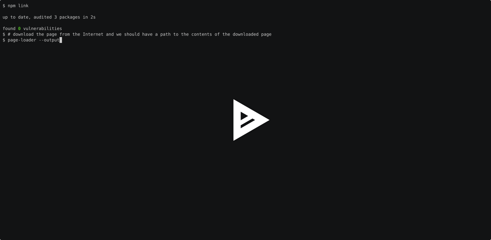
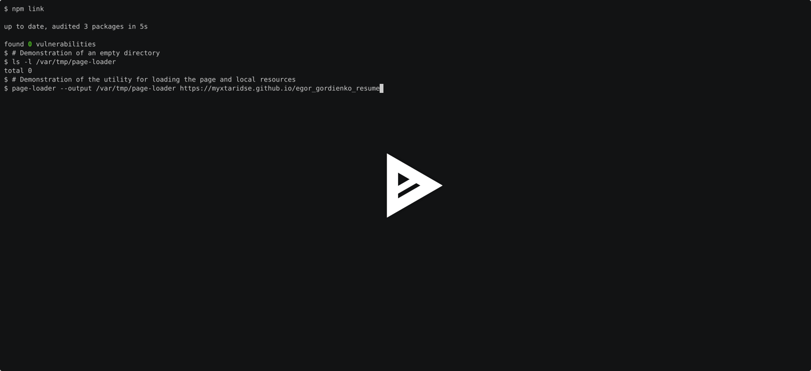
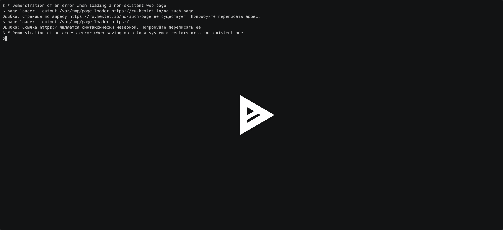

### Hexlet tests and linter status:
[](https://github.com/myxtaridse/js-async-project-4/actions) [](https://github.com/myxtaridse/js-async-project-4/actions/workflows/test-check.yml) [](https://sonarcloud.io/summary/new_code?id=myxtaridse_js-async-project-4) [](https://sonarcloud.io/summary/new_code?id=myxtaridse_js-async-project-4)

# Загрузчик страницы

**«Загрузчик страницы»** - это CLI-утилита для загрузки веб-страниц и связанных с ними ресурсов с сохранением на компьютере. Это дает возможность открывать загруженную страницу локально вместе с сохраненными ресурсами.

## Требования:
- Unix system (Macos/Linux)
- Nodejs 22.x+
- Make

## Описание:
Утилита предоставляет:
- **Загрузка HTML-страниц:** получение содержимого страницы по указанному URL и сохранение его в виде HTML-файла.
- **Загрузка связанных ресурсов:** поиск и скачивание локальных ресурсов страницы - изображений, таблиц стилей и JS-файлов.
- **Локализация ссылок:** замена исходных адресов ресурсов в HTML-разметке на относительные пути к сохраненным файлам.

## Установка:
```bash
git clone https://github.com/myxtaridse/js-async-project-4.git
cd js-async-project-4
make setup
```

## Использование:
После установки утилита доступна из командной строки
```bash
page-loader -o <outputDir> <targetUrl>
```

**Аргументы и опции:**
- `<targetUrl>` - адрес веб-страницы, которую необходимо скачать.
- `-o, --output <dir>` - директория для сохранения контента. Если опция не указана, используется текущая рабочая директория.

**Пример:**

```bash
page-loader -o /var/tmp https://ru.hexlet.io/courses
```
После выполнения команды HTML-страница и найденные ресурсы будут сохранены в указанной директории. Ссылки на скачанные ресурсы в HTML-файле будут заменены на локальные пути.

## Демонстрация:

### Загрузка страницы
[](https://asciinema.org/a/ZSepKqUSXs99RgNI)

### Загрузка страницы и связанных ресурсов с отображением прогресса
[](https://asciinema.org/a/S93H5Z9JpzulWO1O)

### Обработка ошибок и корректное завершение программы
[](https://asciinema.org/a/rXLYGTui7EK7rUDb)

## Run tests
```bash
make test
```